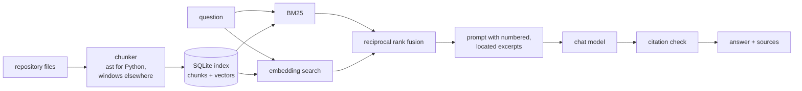

# repolens

Ask questions about a codebase and get answers that point at the exact files and lines, with every citation checked against the code the model was actually shown.

```text
$ repolens search "where is the Authorization header dropped on redirect to another host" --filter "src/*"

#  location                          symbol                                  bm25  dense
1  src/requests/sessions.py:282-300  SessionRedirectMixin.rebuild_auth          1      2
2  src/requests/sessions.py:127-157  SessionRedirectMixin.should_strip_auth     3      1
3  src/requests/sessions.py:302-331  SessionRedirectMixin.rebuild_proxies       2      5
4  src/requests/auth.py:285-303      HTTPDigestAuth.__call__                    4      3
5  src/requests/sessions.py:390-449  Session.__init__                           6     11
```

`repolens ask` sends the retrieved code to a language model and prints the answer, followed by its sources. Each `[path:start-end]` citation in the answer is matched against the retrieved chunks; a citation the model made up is flagged instead of being shown as a source.

## Why

- `grep` finds names, not ideas. "Where do we drop credentials on redirect?" doesn't contain the word `rebuild_auth`.
- Chatting with a model about a repo it can't see produces confident answers with invented file names.
- Pasting files into a chat window doesn't scale past a handful of files.

repolens indexes the repository locally, retrieves the few pieces of code that matter for a question, and makes the model answer from those pieces only.

## Features

- **Structure-aware chunking.** Python files are split along functions, classes and methods with the `ast` module, so a chunk is usually one whole definition labelled with its qualified name (`Session.request`). Other languages use overlapping line windows labelled with the first definition or heading found.
- **Hybrid retrieval.** BM25 over code-aware tokens (`getEnvironProxies` and `get_environ_proxies` both match "environ proxies") combined with embedding search through reciprocal rank fusion.
- **Checked citations.** Answers must cite `[path:start-end]`; citations that don't overlap a retrieved chunk are reported.
- **Incremental index.** One SQLite file in `.repolens/`. Files are hashed, so re-indexing only touches what changed; deleted files drop out.
- **Any model.** Works with any OpenAI-compatible endpoint: a local [Ollama](https://ollama.com) model (the default, no key needed), OpenAI, Groq, OpenRouter, Together, vLLM or LM Studio.
- **Local embeddings.** With the `local` extra, embeddings run on CPU through [fastembed](https://github.com/qdrant/fastembed) (ONNX, `BAAI/bge-small-en-v1.5`). Without it, repolens falls back to keyword search and still works.
- **CLI and web UI.** `search`, `ask`, a multi-turn `chat`, and `serve` for a small browser UI where citations jump to the code they point at.

## Quick start

```bash
pip install "repolens[local,web] @ git+https://github.com/SiddharthTandon/repolens"

cd path/to/your/repo
repolens index                      # builds .repolens/index.db
repolens search "how are retries configured"
```

Answering needs a chat model. With Ollama running locally:

```bash
ollama pull qwen2.5-coder:7b
repolens ask "how is the retry backoff computed?"
repolens chat                       # follow-up questions keep context
repolens serve                      # http://127.0.0.1:8000
```

With a hosted model, point repolens at any OpenAI-compatible API:

```bash
export REPOLENS_BASE_URL=https://api.openai.com/v1
export REPOLENS_API_KEY=sk-...
export REPOLENS_MODEL=gpt-4o-mini
repolens ask "where is the session cookie validated?"
```

## How it works



1. **Discover** files with `git ls-files` (so `.gitignore` is respected), skipping vendored folders, lock files, minified bundles, binaries and files over 512 KB.
2. **Chunk** each file and store the chunks, their line ranges and their embeddings in SQLite. A file's SHA-256 decides whether it needs re-chunking.
3. **Retrieve** the top 50 candidates from BM25 and from cosine similarity, then fuse them: `score(d) = Σ 1 / (60 + rank)`. Chunks that both rankers like rise to the top.
4. **Prompt** the model with the question and the best excerpts (up to a character budget), each headed by its location. The system prompt requires a citation after every claim and an explicit "not in the excerpts" instead of a guess.
5. **Check** every citation in the answer against the retrieved chunks and list the sources with ✓ or ✗.

## Retrieval benchmark

`eval/requests_questions.jsonl` holds 30 questions about [psf/requests](https://github.com/psf/requests) (tag `v2.32.3`), each with the file(s) that answer it. A question counts as found at *k* when one of the top *k* chunks comes from an expected file. The whole repository is indexed, tests and docs included, so they compete with the source files.

| search | recall@1 | recall@3 | recall@5 | recall@10 | MRR |
|---|---|---|---|---|---|
| keyword (BM25) | 0.40 | 0.73 | 1.00 | 1.00 | 0.601 |
| embeddings (bge-small) | 0.70 | 0.83 | 0.87 | 1.00 | 0.788 |
| hybrid (RRF) | 0.60 | 0.90 | 0.97 | 1.00 | 0.735 |

76 files, 730 chunks, indexed in about 80 s on a laptop CPU including the model download. Embeddings are best at putting the right file first; BM25 catches exact names that embeddings miss; the fused ranking gives the best recall in the top three, which is what the model sees first. Reproduce with:

```bash
git clone --depth 1 --branch v2.32.3 https://github.com/psf/requests /tmp/requests
python eval/run_eval.py /tmp/requests eval/requests_questions.jsonl --embedder local --misses
```

## Configuration

| variable | default | meaning |
|---|---|---|
| `REPOLENS_BASE_URL` | `http://localhost:11434/v1` | OpenAI-compatible endpoint (falls back to `OPENAI_BASE_URL`) |
| `REPOLENS_API_KEY` | `ollama` | API key (falls back to `OPENAI_API_KEY`) |
| `REPOLENS_MODEL` | `qwen2.5-coder:7b` | chat model |
| `REPOLENS_EMBEDDER` | `auto` | `local`, `openai`, `none`, or `auto` (local if installed, else keyword only) |
| `REPOLENS_EMBED_MODEL` | backend default | `BAAI/bge-small-en-v1.5` locally, `text-embedding-3-small` via API |

Changing the embedder rebuilds the vectors on the next index run.

## Commands

```text
repolens index [PATH] [--embedder auto|local|openai|none]
repolens search QUERY [--path P] [-k N] [--mode hybrid|lexical|dense] [--filter GLOB] [--code]
repolens ask QUESTION [--path P] [-k N] [--filter GLOB] [--no-stream] [--show-context]
repolens chat [--path P]
repolens serve [--path P] [--port 8000]
repolens stats [--path P]
```

`search` and `ask` refresh the index incrementally first (`--no-refresh` skips it). `ask` exits with status 1 when the answer contains a citation that isn't backed by retrieved code, so it can be used in scripts.

## Development

```bash
python -m venv .venv && . .venv/bin/activate
pip install -e ".[dev,web]"
ruff check .
pytest
```

The tests run offline: a hashing embedder stands in for the model-based one and an `httpx.MockTransport` plays the chat API, including streaming.

## Limitations and next steps

- Non-Python files are chunked by line windows; tree-sitter grammars would give real symbol boundaries for JavaScript, Go, Rust and Java.
- Retrieval is single-shot. Following imports and call sites from the first hits (a small code graph) would help questions that span several layers.
- A cross-encoder reranker over the fused top 20 is the obvious next step for rank-1 precision.
- Citations are checked for location, not for whether the cited lines really say what the answer claims.

## License

MIT
